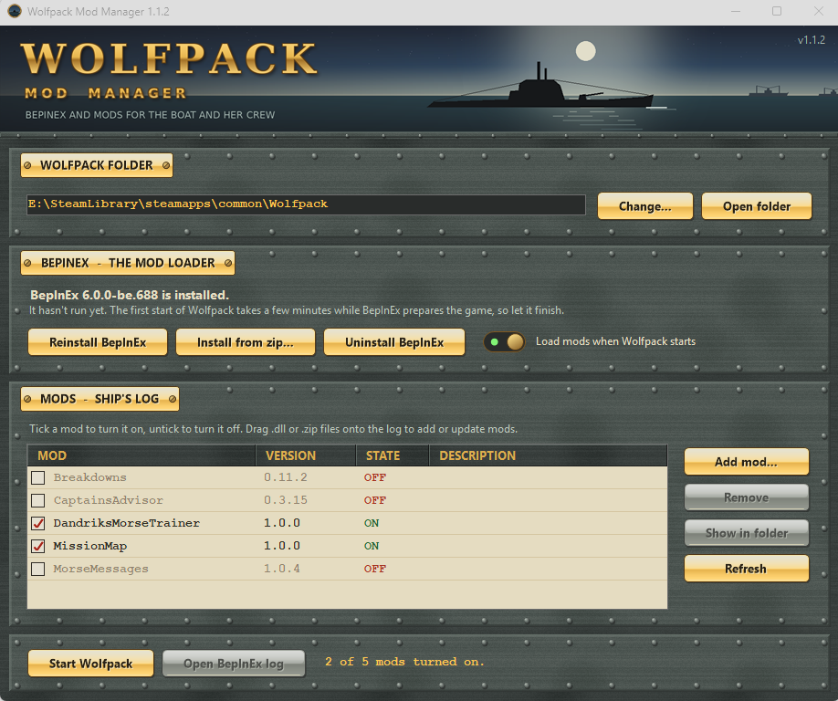

# Wolfpack Mod Manager

A small Windows app that sets up mods for the U-boat game [Wolfpack](https://store.steampowered.com/app/490920/Wolfpack/). It installs BepInEx for you and lets you add, update, switch off and remove mods without digging through the game folder.

## What it does

- Finds your Wolfpack folder through Steam, or lets you pick it yourself.
- Installs BepInEx (the loader that mods need) with one click, using the build Wolfpack mods are made for. It can also install from a zip you downloaded, or remove BepInEx again.
- Lists your mods with their versions. Tick a mod to turn it on, untick it to turn it off.
- Adds or updates a mod from its .zip or .dll. Drag the file onto the list or use Add mod. Zips with extra folders inside are handled.
- Removes mods to the Recycle Bin, so a mistake can be undone.
- Has one switch to turn every mod off and play the unmodded game, without uninstalling anything.
- Never overwrites your mod settings in `BepInEx\config`.

## Download

Get `WolfpackModManager.exe` from the [Releases](../../releases) page. It is a single file and needs nothing installed. It runs on Windows 10 and 11.

The exe is digitally signed. Windows may still show a "Windows protected your PC" notice for a while after a new release. Click More info, check the publisher name, then Run anyway.

## How to use it

1. Close Wolfpack.
2. Run `WolfpackModManager.exe`. If it can't find the game, click Change and pick the folder that has `Wolfpack.exe` in it. In Steam that is right-click Wolfpack, Manage, Browse local files.
3. Click Install BepInEx.
4. Click Add mod, or drag a mod's .zip or .dll onto the list.
5. Start Wolfpack. The first start after installing BepInEx takes a few minutes while it prepares the game. Let it finish.

Mods you switch off are moved to `BepInEx\plugins_disabled` and come back when you tick them again.

## If something goes wrong

- If the BepInEx download fails, download the zip in your browser from the address the app shows, then use Install from zip.
- The game's mod log is `BepInEx\LogOutput.log` in the Wolfpack folder. The Open BepInEx log button opens it.
- The app's own log is at `%AppData%\WolfpackModManager\log.txt`.
- Report problems on the [Issues](../../issues) page and attach both logs if you can.

## Credits and license

BepInEx is a separate project, licensed under LGPL-2.1, and is not included here. The app downloads it from the official BepInEx site when you ask it to. See https://github.com/BepInEx/BepInEx.

This is an unofficial fan project. It is not affiliated with or endorsed by the makers of Wolfpack.

The Mod Manager is free to use and share unmodified. The source code is not published. See [LICENSE](LICENSE) for the terms.
